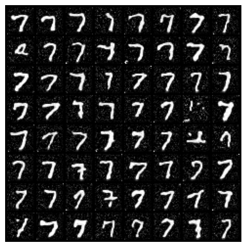
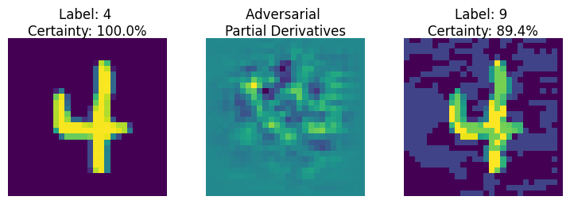
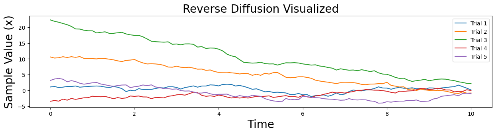
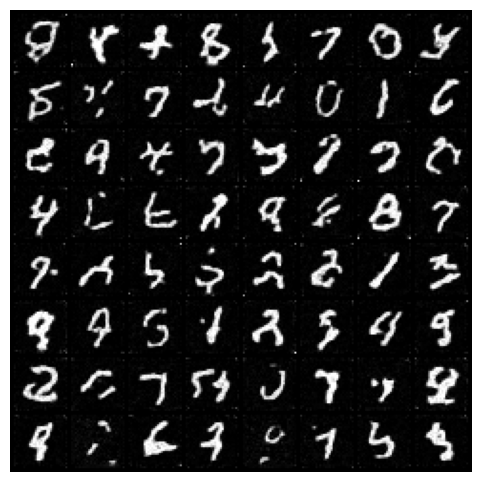

# GANs, Adversarial Examples and Diffusion Models

Generative modelling on MNIST, from the original GAN objective to a score-based diffusion model with a transformer-conditioned U-Net, plus adversarial attacks on a classifier.

> Lab 2 of *Advanced Deep Learning (D7047E)*, Luleå University of Technology, spring 2024. Group 7; see [Team](#team).



*Conditional diffusion: every sample was generated from noise after asking the model for a "7".*

## Contents

### 2.1–2.2 GANs: why the loss function matters
A generator and discriminator trained on MNIST with the **original minimax objective**, then with the **non-saturating loss**. The minimax version gives the generator vanishing gradients early in training, when the discriminator easily rejects its samples; the non-saturating loss fixes this by maximising log D(G(z)) instead.

### 2.3 Conditional GAN
Feeding the digit label to both networks so the generator produces a requested digit rather than a random one.

### 2.4 Adversarial examples
A CNN classifier trained to **99.1% test accuracy**, then fooled with a small, almost invisible perturbation built from the gradient of the loss with respect to the input:



*A "4" classified with 100% certainty becomes a "9" with 89% certainty after adding the perturbation in the middle.*

### 2.5 Diffusion models
- Forward and reverse diffusion implemented from first principles in 1D, to see how noise is added and removed.
- A **score-based diffusion model** on MNIST: a time-conditioned U-Net with Gaussian Fourier time embeddings, then a residual U-Net.
- **Conditional generation** with a U-Net that uses cross-attention transformer blocks to take the digit label.

<p>


</p>

## Running the code (VS Code / Python)

Everything is implemented in PyTorch in the `genmodels/` package, with one command per experiment. MNIST downloads automatically to `data/raw/`; images go to `outputs/` and trained models to `checkpoints/`.

```bash
python -m venv .venv
source .venv/bin/activate        # Windows: .venv\Scripts\activate
pip install -r requirements.txt

python main.py gan --preset minimax                  # 2.1
python main.py gan --preset non-saturating           # 2.2
python main.py gan --preset conditional              # 2.3, one row of samples per digit
python main.py adversarial --source 4 --target 9     # 2.4
python main.py diffusion-1d                          # 2.5, 1D forward/reverse diffusion plots
python main.py diffusion-train --model unet          # 2.5: unet | unet_res | transformer
python main.py diffusion-sample --model transformer --digit 7
```

Every command takes `--help`; defaults are the notebooks' hyperparameters (e.g. `--iterations`, `--epochs`, `--lr` can be overridden for quicker runs). In VS Code, open the folder, select the `.venv` interpreter and use the **Run and Debug** panel (`.vscode/launch.json` has a configuration per experiment). `pytest` runs fast smoke tests.

| Path | Contents |
|---|---|
| [`main.py`](main.py) | Command-line entry point |
| [`genmodels/gan.py`](genmodels/gan.py) | Generator/discriminator, minimax and non-saturating losses, conditional GAN |
| [`genmodels/adversarial.py`](genmodels/adversarial.py) | MNIST CNN and targeted fast-gradient-sign attack |
| [`genmodels/diffusion.py`](genmodels/diffusion.py) | 1D demos, VE-SDE, three U-Nets (incl. cross-attention), score-matching loss, Euler-Maruyama sampler |

## Original notebooks

| Notebook | Topic | Framework |
|---|---|---|
| [`2.1_gan_minimax.ipynb`](notebooks/2.1_gan_minimax.ipynb) | GAN with minimax loss | TensorFlow |
| [`2.2_gan_non_saturating_loss.ipynb`](notebooks/2.2_gan_non_saturating_loss.ipynb) | GAN with non-saturating loss | PyTorch/TensorFlow |
| [`2.3_conditional_gan.ipynb`](notebooks/2.3_conditional_gan.ipynb) | Conditional GAN | PyTorch/TensorFlow |
| [`2.4_adversarial_examples.ipynb`](notebooks/2.4_adversarial_examples.ipynb) | Adversarial attacks on a CNN | TensorFlow |
| [`2.5_diffusion_models.ipynb`](notebooks/2.5_diffusion_models.ipynb) | Score-based diffusion, U-Net, cross-attention | PyTorch |

The notebooks need `tensorflow` and `einops` in addition to the packages in `requirements.txt`.

## Team

Group 7, D7047E Advanced Deep Learning: **Aamer Barood** and teammates. The original group repository, with full commit history, is [Gabmyr/D7047E-Labs-Group-7](https://github.com/Gabmyr/D7047E-Labs-Group-7).
